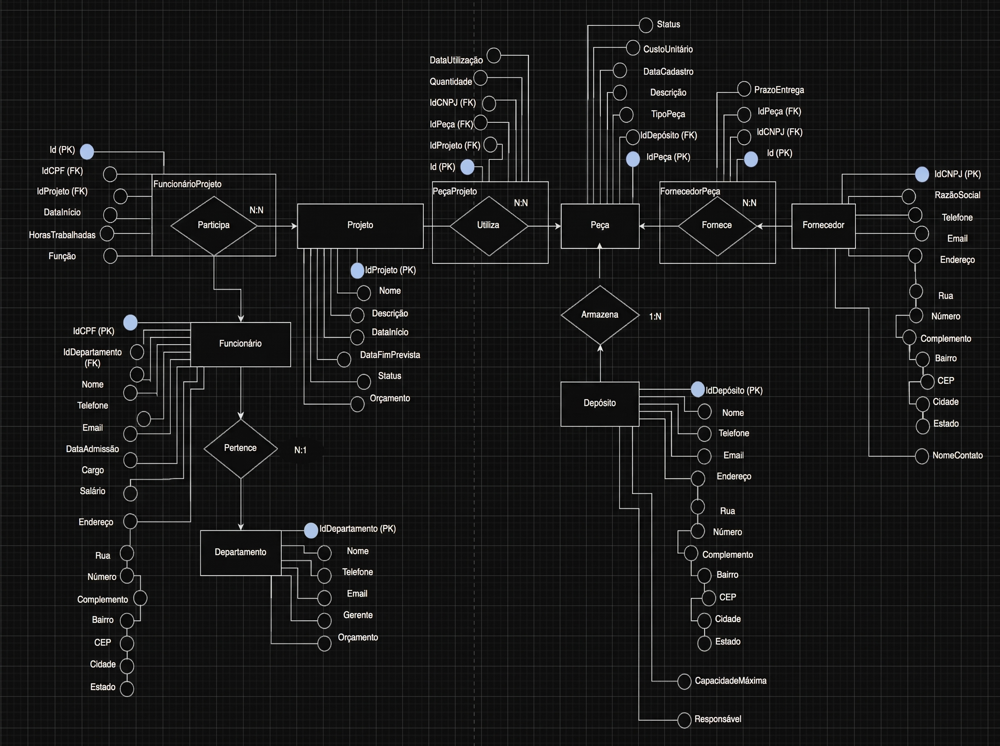

  
｡ﾟ☁︎｡⋆｡ ﾟ☾ ﾟ｡⋆ ──────────── ꒰ 🗄️ ꒱ ──────────── ⋆｡ﾟ☾ ﾟ｡⋆｡☁︎｡ﾟ

  <h1>˚₊‧꒰ა 🪻 Modelagem de Banco de Dados Relacional & SQL 🪻 ໒꒱‧₊˚</h1>

  

    <i>✧･ﾟ: *✧･ﾟ:* Modelagem Conceitual Entidade-Relacionamento (MER) e implementação de banco de dados relacional em MySQL cobrindo desenho de schema, população de dados e consultas analíticas *:･ﾟ✧*:･ﾟ✧</i>
  

  

    
    
    
  

 

‧₊˚ ☁️⋅♡𓂃 ࣪ ִֶָ☾. ─────────────────────── ‧₊˚ ☁️⋅♡𓂃 ࣪ ִֶָ☾.

### ╰┈➤ ꒰ 🪞 ꒱ Etapa 1 — Modelagem Conceitual (`MER`)

- **₊˚📎 Domínio:** Sistema de Gestão Industrial Corporativa (`Projetos`, `Funcionários`, `Departamentos`, `Peças`, `Almoxarifados` e `Fornecedores`).
- **₊˚🧁 Artefatos:** Diagrama Entidade-Relacionamento definindo entidades, atributos compostos/multivalorados, cardinalidades (`1:N`, `N:N`), Chaves Primárias (`PK`) e Chaves Estrangeiras (`FK`).

‧₊˚ ☁️⋅♡𓂃 ࣪ ִֶָ☾. ─────────────────────── ‧₊˚ ☁️⋅♡𓂃 ࣪ ִֶָ☾.

### ╰┈➤ ꒰ 🪷 ꒱ Etapa 2 — Implementação Física (`MySQL`)

- **₊˚📎 Domínio:** Assistência Técnica de TI e Gestão de Ordens de Serviço (banco `Empresa`).
- **₊˚🧁 Estrutura / Schema (`DDL`):** Criação das tabelas `Tecnico`, `Cliente`, `Servico`, `Finalizacao`, `OrdemServico` e da tabela associativa `OrdemServico_Servico` com `AUTO_INCREMENT`, `ENUM`, `NOT NULL` e restrições de integridade referencial.
- **₊˚📎 População de Dados (`DML`):** Scripts estruturados de `INSERT` populando clientes, técnicos, catálogo de serviços, ordens concluídas e chamados abertos/em andamento.
- **₊˚🧁 Consultas Analíticas (`DQL`):** Relatórios de negócio utilizando `COUNT`, `WHERE`, `ORDER BY`, `INNER JOIN`, `GROUP BY` e `SUM`.

‧₊˚ ☁️⋅♡𓂃 ࣪ ִֶָ☾. ─────────────────────── ‧₊˚ ☁️⋅♡𓂃 ࣪ ִֶָ☾.

### ╰┈➤ ꒰ 📂 ꒱ Arquivos do Repositório

| Arquivo | Vibe | Descrição |
| :--- | :---: | :--- |
| `database_service_orders.sql` | 🪻 | Script completo em MySQL (`CREATE DATABASE`, `CREATE TABLE`, `INSERT INTO` e consultas `SELECT`) em português |
| `mer.diagram.jpg` | 🪞 | Diagrama Conceitual Entidade-Relacionamento |

 

  
°•. 🪻 .•° ────── ꒰ 💗 ꒱ ────── °•. 🪻 .•°

  
<i>feito com 💗 por <b>Maria Eduarda Gonçalves</b></i>

